# DFM architecture

DFM is a Django 5.2 service on Python 3.13. It coordinates order intake, Shopify order and fulfillment work, COESP provisioning, Smart License activation, HTTP APIs, and AWS message processing.

This document was verified against the main revision recorded in [source status](source-status.md).

## Runtime boundaries

DFM owns local order state, processing state, audit records, outbound SAM records, and operator views. Shopify owns commerce orders and fulfillment orders. COESP owns digital provisioning. SAM sends order intent and receives responses. AWS SQS and SNS carry asynchronous work and notifications.

The Lambda ingress integration shares the order-processing lifecycle contract, but this documentation did not inspect the Lambda repository.

## Django apps

| Path | Responsibility |
| --- | --- |
| `sam_integration/` | Legacy SAM XML and ECEDOC parsing, classification, order creation, refunds, notifications, payload generation, and shared SAM persistence. |
| `sam_nextgen_integration/` | Strict NextGen JSON validation, digital and physical dispatch, Shopify builders/processors, refunds, outbound responses, and durable outbox publication. |
| `shopify_core/` | Shopify client, rate limiter, shared constants, fee helpers, fulfillment audit base model, and audit service. |
| `shopify_orders/` | Paid-order and cancellation workers, order services, payload logs, processing failures, and admin diagnostics. |
| `shopify_fulfillments/` | Fulfillment request and response workers, COESP orchestration, grouping, retry claims, NextGen physical refunds, and SAM status propagation. |
| `shopify_configs/` | Tenant and Shopify configuration. |
| `coesp_client/` | COESP HTTP client, payloads, response classification, and cancellation. |
| `smart_license/` | Activation parsing, status updates, redaction, retries, and DLQ handling. |
| `api/` | API key authenticated POS provision/cancel and SAM pickup-status endpoints. |
| `follett_auth/` and `cognito/` | API keys and interactive Cognito login. |
| `utils/` | Worker pool, retry/DLQ, request correlation, metrics, lifecycle events, encryption, Redis, and shared helpers. |
| `healthcheck/` | Process and database health endpoints. |

## Entry points

HTTP routes:

- `/api/pos/provision`
- `/api/pos/cancel`
- `/api/sam/pickup-status`
- `/api/docs/schema`, `/api/docs/swagger`, `/api/docs/redoc`
- `/healthcheck/` and database health routes
- `/admin/`

The API uses `X-API-Key`. The cache stores active key hashes for one hour and invalidates on key changes. Redis is optional for this cache. Tests and local runs can fall back to process memory.

Async entry points are listed in [workers and messages](workers-and-messages.md).

## Order flow

```mermaid
flowchart LR
  SAM[Legacy SAM or SAM NextGen] --> Intake[SQS intake worker]
  Intake --> Validate[Parse, validate, classify]
  Validate --> State[Local SAM request and order state]
  State --> Shopify[Shopify order or refund]
  Shopify --> Fulfillment[Fulfillment workers]
  Fulfillment --> COESP[COESP or Smart License]
  COESP --> Audit[Fulfillment audit and local status]
  Audit --> Response[SAM response or NextGen outbox]
  Response --> SNS[SNS response topic]
```

Shopify webhooks and queue messages also drive paid-order processing, fulfillment responses, cancellations, refunds, returns, and pickup notifications.

## NextGen scope in current main

NextGen is not digital-only. Current code routes digital, physical, rental, auto-sale, and refund families. `dispatcher.py` selects digital or physical processing. Physical work uses `physical_order_builder.py` and `physical_processor.py`. Refund and fulfillment responses use event-scoped outbox records so retries publish the same stored payload.

Read these source paths when changing NextGen:

- `sam_nextgen_integration/constants.py`
- `sam_nextgen_integration/types.py`
- `sam_nextgen_integration/dispatcher.py`
- `sam_nextgen_integration/validators.py`
- `sam_nextgen_integration/order_repository.py`
- digital and physical builders/processors
- `sam_nextgen_integration/outbound.py`
- `sam_nextgen_integration/OPERATIONS.md`

## Where authority lives

Use code and tests at the active revision for current mechanics. Use Jira and approved decision records for intended behavior. Use the current PR for proposed changes. Treat ATL docs and the handbook as navigation and history until code confirms each claim.
